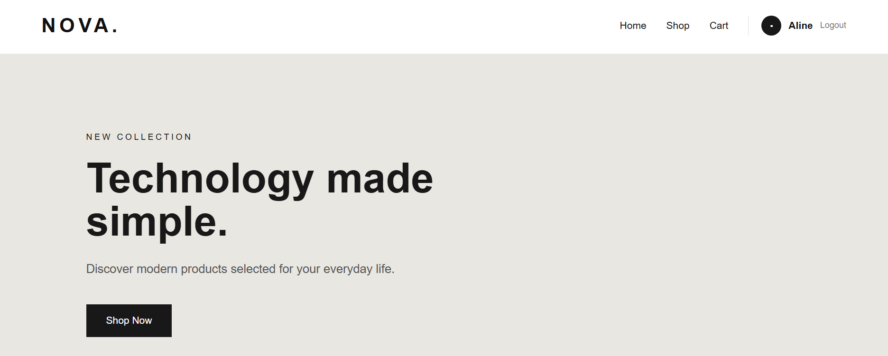
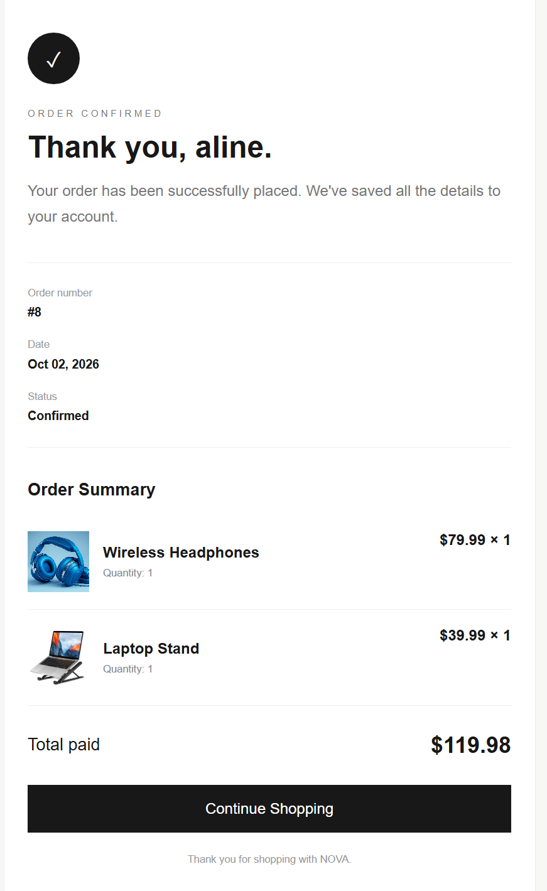

# NOVA. — E-Commerce Web Application

### Modern Technology. Simple Shopping.

NOVA. is a modern, responsive e-commerce web application developed using Python and Django as part of the **CodeAlpha Full Stack Development Internship — October 2026**.

The project demonstrates a complete shopping workflow, from product discovery and user authentication to cart management, order processing, and order confirmation.

NOVA. combines a minimalist user interface with essential e-commerce functionality to deliver a simple and intuitive shopping experience.

---

## Features

### Product Catalog
- Modern product listings with images, descriptions, and prices
- Individual product detail pages
- Real-time product stock information from the database
- In-stock and out-of-stock indicators
- Responsive product cards with hover effects

### User Authentication
- User registration
- Secure password handling using Django authentication
- Login and logout functionality
- Authentication required before checkout

### Shopping Cart
- Session-based shopping cart
- Add products to the cart
- Increase and decrease product quantities
- Remove products from the cart
- Dynamic cart counter
- Automatic subtotal and total calculation
- Stock validation to prevent adding unavailable quantities

### Checkout and Order Processing
- Checkout page with order summary
- Order validation before processing
- Persistent order and order-item storage
- Automatic stock reduction after successful orders
- Database transactions for order consistency
- Automatic cart clearing after successful checkout
- Order confirmation page with order details

### Administration
- Django Admin dashboard
- Product management
- Stock management
- Order and order-item management
- User management

### User Interface
- Minimalist and modern design
- Responsive layout
- Product images
- Interactive buttons and hover effects
- Shopping cart notifications
- Clean order confirmation interface

---

## Technologies Used

| Technology | Purpose |
|------------|---------|
| Python | Backend programming |
| Django | Web framework |
| HTML5 | Website structure |
| CSS3 | Styling and responsive design |
| SQLite | Database |
| Django Sessions | Shopping cart management |
| Django Authentication | User registration and login |
| Git | Version control |
| GitHub | Project hosting and documentation |

---

## Project Structure

```text
Task-1-Ecommerce/
│
├── ecommerce/
│   ├── settings.py
│   ├── urls.py
│   ├── wsgi.py
│   └── asgi.py
│
├── store/
│   ├── migrations/
│   │
│   ├── static/
│   │   └── store/
│   │       ├── images/
│   │       └── style.css
│   │
│   ├── templates/
│   │   └── store/
│   │       ├── home.html
│   │       ├── product_detail.html
│   │       ├── cart.html
│   │       ├── checkout.html
│   │       ├── login.html
│   │       ├── register.html
│   │       └── order_success.html
│   │
│   ├── admin.py
│   ├── context_processors.py
│   ├── models.py
│   ├── urls.py
│   └── views.py
│
├── screenshots/
│   ├── home.png
│   ├── products.png
│   ├── product-detail.png
│   ├── cart.png
│   └── order-confirmation.png
│
├── manage.py
├── requirements.txt
├── .gitignore
└── README.md
```

---

## Application Workflow

The main shopping process follows these steps:

**Browse Products → View Product Details → Add to Cart → Login/Register → Checkout → Place Order → Order Confirmation**

1. Users explore the available products.
2. Users view detailed product information.
3. Products are added to a session-based shopping cart.
4. Users can modify quantities or remove products.
5. Authentication is required before checkout.
6. The application validates product availability.
7. Orders and order items are saved in the database.
8. Product stock is automatically updated.
9. The cart is cleared and an order confirmation is displayed.

**Note:** This application demonstrates an e-commerce order-processing workflow. No real payment gateway is integrated.

---

## Screenshots

### Home Page



### Product Collection


### Product Details


### Shopping Cart


### Order Confirmation



---

## Installation and Setup

### 1. Clone the Repository

```bash
git clone https://github.com/Aline302/codealpha_tasks.git
cd codealpha_tasks/Task-1-Ecommerce
```

### 2. Create a Virtual Environment

```bash
python -m venv venv
```

### 3. Activate the Virtual Environment

**Windows (PowerShell):**

```powershell
.\venv\Scripts\Activate.ps1
```

**Windows (Command Prompt):**

```cmd
venv\Scripts\activate.bat
```

**macOS / Linux:**

```bash
source venv/bin/activate
```

### 4. Install Dependencies

```bash
python -m pip install -r requirements.txt
```

### 5. Apply Database Migrations

```bash
python manage.py migrate
```

### 6. Start the Development Server

```bash
python manage.py runserver
```

### 7. Open the Website

Visit:

http://127.0.0.1:8000/

### 8. Create an Administrator Account (Optional)

```bash
python manage.py createsuperuser
```

Access Django Admin at:

http://127.0.0.1:8000/admin/

**Important:** Since the local SQLite database is excluded from Git, a fresh installation starts without product records. Create products through Django Admin before testing the shopping workflow.

---

## Technical Implementation

### Database Models

The application uses Django models to manage products, orders, and order items.

- **Product:** Stores product information, pricing, images, and available stock.
- **Order:** Stores customer orders, totals, status, and creation information.
- **OrderItem:** Stores the products and quantities associated with an order.

### Session-Based Cart

The shopping cart is stored using Django sessions, allowing users to manage their selected products before checkout.

### Stock Validation

Product stock is checked when adding products and before order processing. Products with insufficient stock cannot be purchased through the standard shopping workflow.

### Order Processing

The checkout workflow uses Django database transactions to help ensure that order creation, order-item storage, and stock updates are processed consistently.

### Authentication

Django's built-in authentication system manages user accounts and login sessions.

The checkout process is restricted to authenticated users.

---

## Future Improvements

Potential enhancements include:

- Product search and category filters
- Wishlist functionality
- Customer order history
- Online payment gateway integration
- Product ratings and reviews
- Email order notifications
- Cloud deployment

These features are proposed improvements and are not part of the current implementation.

---

## Internship Information

**Program:** CodeAlpha Full Stack Development Internship  
**Batch:** October 1–30, 2026  
**Project:** Task 1 — E-Commerce Website  
**Application:** NOVA.

This project was developed to practice full-stack web development, database management, user authentication, and e-commerce application design.

---

## Author

**Aline Charafeddine**

Software Engineering Student

GitHub: [Aline302](https://github.com/Aline302)

---

**NOVA. — Technology made simple.**
